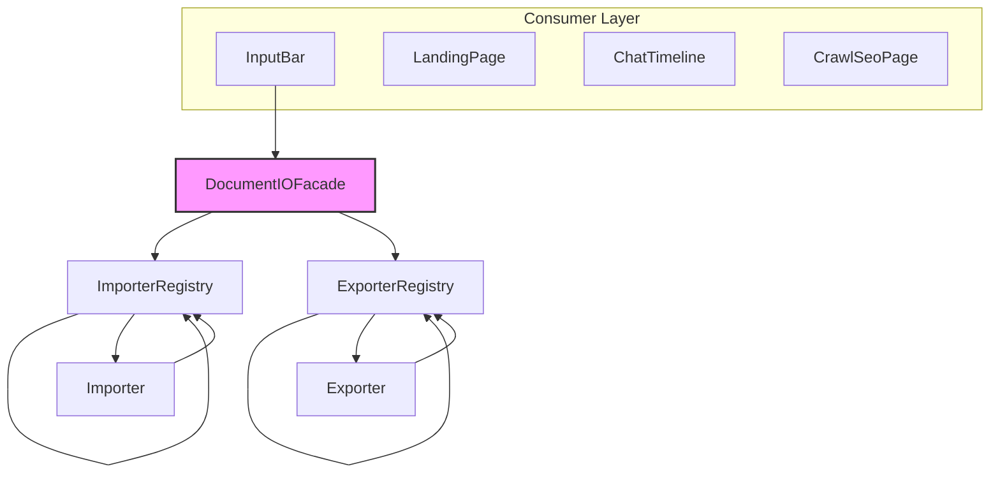

# DocumentIO — High-Level Design (HLD)

> **Module:** `VnMLStudio.Plugin.MMO.DocumentIO`
> **Version:** 1.0
> **Status:** Active
> **Last updated:** 2026-10-15

---

## 1. Purpose

DocumentIO cung cấp khả năng **import** (đọc file → text) và **export** (text/markdown → file) cho nhiều định dạng tài liệu — Word, Excel, PDF, Text — với kiến trúc có thể mở rộng mà không cần sửa code core.

**Ngữ cảnh sử dụng:**
- Cho phép user attach file Word/Excel/PDF vào chat → extract text → đưa vào LLM prompt.
- Cho phép user export chat/conversation ra Word/Excel/PDF để chia sẻ hoặc lưu trữ.

**Non-goals:**
- Không phải document editor.
- Không xử lý realtime collaboration.
- Không phải file storage service (chỉ đọc/ghi local file).

---

## 2. Scope

### In scope
- 4 format: Text/Markdown, Word (.docx), Excel (.xlsx), PDF (.pdf).
- Import: extract text + metadata (title, author, word count, page count).
- Export: nhận markdown/plain text → render ra format đích.
- Attachment workflow integration (InputBar, LandingPage, CrawlSeoPage).
- Error handling có user feedback (chip lỗi + tooltip + retry).

### Out of scope
- Import/export `.doc` (legacy binary), `.xls`, `.ppt`, `.pptx`.
- OCR cho scanned PDF (chỉ extract text layer).
- Image extraction trong PDF (chỉ placeholder text).
- Cloud storage integration.

---

## 3. Architecture Overview



**Flow:**
1. **Consumer Layer** sử dụng `DocumentIOFacade` để thực hiện các tác vụ.
2. **`DocumentIOFacade`** che giấu toàn bộ complexity (registry, handler dispatch, error handling).
3. **`ImporterRegistry`** và **`ExporterRegistry`** resolve handler dựa trên file extension / `DocumentFormat`.
4. Các handler cụ thể (`TextDocumentImporter`, `WordDocumentExporter`, v.v.) được inject thông qua Dependency Injection (DI).

---

## 4. Key Design Decisions

### 4.1. Strategy Pattern for Format Handlers
Mỗi format là một strategy độc lập implement `IDocumentImporter` hoặc `IDocumentExporter`. Thêm format mới = thêm class mới, không sửa class cũ (**Open/Closed Principle**).

### 4.2. Registry Pattern for Resolution
`DocumentImporterRegistry` và `DocumentExporterRegistry` resolve handler dựa trên file extension / `DocumentFormat` enum. Registry được inject qua DI với collection of handlers — không hardcode danh sách.

### 4.3. Facade Pattern for Consumers
`DocumentIOFacade` che giấu toàn bộ complexity (registry, handler dispatch, error handling). Consumers chỉ cần:
```csharp
var result = await facade.ImportAsync(path);
var export = await facade.ExportAsync(DocumentFormat.Word, request);
```

### 4.4. Fail-Safe Result Types
Không throw exception ra ngoài boundary. Mọi operation trả về `ImportResult` / `ExportResult` với `Success`, `ErrorMessage`, và `data`. Consumers không cần `try/catch` cho business errors.

### 4.5. Attachment Workflow Integration
DocumentIO không trực tiếp biết về Attachment. UI layer (InputBar, LandingPage) chịu trách nhiệm:
1. Detect file có cần import không (extension check).
2. Gọi `DocumentIOFacade.ImportAsync`.
3. Convert `ImportResult.Text` → temp file Attachment (để gửi cho LLM sau này).
Điều này giữ DocumentIO không phụ thuộc vào UI models.

---

## 5. Data Flow

### 5.1. Import Flow (user attach file)
1. User attaches "report.docx".
2. `InputBar.addFiles()` — detect `.docx` ∈ `ImportableExtensions`.
3. `DocumentIOFacade.ImportAsync(path)`.
4. `ImporterRegistry.Resolve(path)` → `WordDocumentImporter`.
5. `WordDocumentImporter.ImportAsync(path)` → OpenXml opens file → extract paragraphs + tables + images + metadata.
6. Trả về `ImportResult { Success, Text, Metadata }`.
7. `InputBar` convert `Text` → temp `.txt` file → `Attachment`.

### 5.2. Export Flow (user saves chat)
1. User clicks "Export" on assistant message.
2. `ChatTimeline.ExportAssistantMessageAsync(text, entryId)`.
3. Build markdown content from text.
4. `SaveFilePicker` → user picks format (.docx / .xlsx / .pdf / .md / .txt).
5. `DocumentIOFacade.ExportAsync(format, request)`.
6. `ExporterRegistry.Resolve(format)` → `WordDocumentExporter`.
7. `WordDocumentExporter` parse markdown → WordprocessingDocument.
8. Trả về `ExportResult { Success, OutputPath }`.

---

## 6. External Dependencies

| Package | Version | Purpose | License |
| :--- | :--- | :--- | :--- |
| `DocumentFormat.OpenXml` | 3.1.0 | Word read/write, image embedding | MIT (Microsoft) |
| `ClosedXML` | 0.104.1 | Excel read/write (data only) | MIT |
| `NPOI` | 2.7.1 | Excel export with charts | Apache 2.0 |
| `QuestPDF` | 2024.12.3 | PDF export | Community (free < $1M revenue) |
| `UglyToad.PdfPig` | 0.1.9 | PDF text extraction | Apache 2.0 |
| `SixLabors.ImageSharp` | 3.1.5 | Image dimension detection | Apache 2.0 / Commercial dual |

**License note:** `QuestPDF` yêu cầu license thương mại nếu công ty > $1M revenue. VNML Studio cần verify trước khi deploy enterprise.

---

## 7. Configuration

### 7.1. DI Registration
```csharp
services.AddDocumentIO();
// Đăng ký:
// 4 IDocumentImporter (singleton)
// 4 IDocumentExporter (singleton)
// 2 Registry (singleton)
// 1 DocumentIOFacade (singleton)
```

### 7.2. Runtime Limits

| Limit | Value | Location |
| :--- | :--- | :--- |
| Max file size inline | 200 KB | WordDocumentExporter, PdfDocumentExporter |
| Max total inline budget | 400 KB / turn | ReflectiveStreamingAgentHarness |
| Large text paste threshold | 5000 chars | InputBar, LandingPage |
| PDF page limit | Unlimited (warn if >100) | (roadmap) |
| Excel sheet limit | Unlimited | — |

---

## 8. Error Handling Strategy

### 8.1. Recoverable errors (return Result.Fail)
- File not found
- Corrupt file (invalid OOXML package)
- Password-protected file
- Unsupported format
- I/O errors

### 8.2. UI Response
- Import fail → error chip ⚠️ + tooltip detail + retry option.
- Export fail → InfoBar notification with ErrorMessage.
- Partial success (e.g., extract text but skip images) → vẫn là Success, log warning.

### 8.3. Logging
Mọi operation log:
- `LogDebug` — before/after handler dispatch.
- `LogInformation` — success with metadata (word count, page count).
- `LogWarning` — recoverable error.
- `LogError` — unexpected exception.

---

## 9. Security Considerations

| Concern | Mitigation |
| :--- | :--- |
| Malicious docx | OpenXml chạy trong `Task.Run` isolated, không execute macros (`isEditable: false`) |
| Zip bomb | Future: check decompressed size before write |
| Large file DoS | 200 KB inline limit; recommend max 50 MB file size check |
| Path traversal | Only accept paths from `FileOpenPicker` / `FileSavePicker` (OS-sanitized) |
| Info leak in metadata | Author/CreatedAt only exposed via `DocumentMetadata`, controlled by caller |
| Prompt injection via attachments | Wrapped in `"UNTRUSTED DATA"` fence trước khi inline vào prompt |

---

## 10. Testing Strategy

### 10.1. Unit tests
- `MarkdownParser` — parse headings, bullets, tables, code blocks, images.
- `SyntaxHighlighter` — tokenize C#, JS, Python, SQL.
- Each importer/exporter — round-trip small files.

### 10.2. Integration tests
- Import → export → re-import → verify content identical (for text formats).
- Attachment workflow: mock file → verify temp file created.

### 10.3. Manual QA matrix

| Format | Import | Export | Notes |
| :--- | :--- | :--- | :--- |
| `.txt` | ✅ | ✅ | UTF-8 BOM preserved |
| `.docx` | ✅ | ✅ | Images, tables |
| `.xlsx` | ✅ | ✅ | Charts (via NPOI) |
| `.pdf` | ✅ | ✅ | Syntax highlighting |

---

## 11. Known Limitations

| Limitation | Impact | Roadmap |
| :--- | :--- | :--- |
| PDF: no image extraction | Images shown as `[Image: alt]` placeholder | v1.1 |
| Excel: charts limited | Line/Bar/Area/Radar only; no Pie/Scatter | v1.1 |
| Word: inline bold/italic stripped | `**bold**` → bold (no formatting) | v1.2 |
| No OCR | Scanned PDFs return empty text | v2.0 |
| No `.doc`/`.xls` legacy support | User must convert to OOXML first | Out of scope |

---

## 12. Future Extensions

Các format có thể thêm mà không sửa core:
- **PowerPoint (.pptx)** — slide text extraction
- **RTF** — rich text
- **HTML** — web page → markdown
- **EPUB** — ebook extract
- **CSV/TSV** — dedicated structured parser

Mỗi format = 1 importer + 1 exporter + 2 dòng DI. Không cần sửa Facade, Registry, hoặc consumers.

---

## 13. References

- Detail Design Document
- Architecture Decision Record: Chart Library Choice
- QuestPDF License
- OpenXML SDK Docs

***

# DocumentIO — Detailed Design (DDD)

> **Module:** `VnMLStudio.Plugin.MMO.DocumentIO`
> **Version:** 1.0
> **Companion:** [High-Level Design](./DocumentIO-HighLevelDesign.md)

---

## 1. Namespace Layout

```csharp
VnMLStudio.Plugin.MMO.DocumentIO
├── Abstractions.cs (enums, records, interfaces)
├── DocumentIOFacade.cs (facade)
├── DocumentIORegistry.cs (2 registries)
├── DocumentIOExtensions.cs (DI registration)
├── Parsers/
│ └── MarkdownParser.cs (shared markdown parser)
├── Importers/
│ ├── TextDocumentImporter.cs
│ ├── WordDocumentImporter.cs
│ ├── ExcelDocumentImporter.cs
│ └── PdfDocumentImporter.cs
├── Exporters/
│ ├── TextDocumentExporter.cs
│ ├── WordDocumentExporter.cs
│ ├── ExcelDocumentExporter.cs
│ ├── PdfDocumentExporter.cs
│ └── NpoiChartBuilder.cs
└── SyntaxHighlighting/
├── SyntaxHighlighter.cs
└── SyntaxTheme.cs
```

---

## 2. Type Reference

### 2.1. `DocumentFormat` (enum)

```csharp
public enum DocumentFormat
{
    Unknown,    // Cannot determine
    Text,       // .txt, .log, .csv
    Markdown,   // .md, .markdown
    Word,       // .docx
    Excel,      // .xlsx, .xlsm
    Pdf         // .pdf
}
```
*Note: Text và Markdown map to same importer/exporter (TextDocumentImporter/Exporter) nhưng là các giá trị enum khác nhau để phân biệt ý định.*

### 2.2. `ImportResult` (record)

```csharp
public sealed record ImportResult(
    bool Success,
    string Text,
    DocumentMetadata Metadata,
    string? ErrorMessage = null)
{
    public static ImportResult Ok(string text, DocumentMetadata metadata);
    public static ImportResult Fail(string error);
}
```
**Invariants:**
- `Success == false` → `Text == ""` và `ErrorMessage != null`.
- `Success == true` → `Text != null` (có thể rỗng đối với tài liệu trống).
- `Metadata` never null (sử dụng `DocumentMetadata.Empty` làm fallback).

### 2.3. `ExportRequest` (record)

```csharp
public sealed record ExportRequest(
    string TargetPath,
    string Content,
    string? Title = null,
    DocumentMetadata? Metadata = null)
{
    public string EffectiveTitle { get; }
}
```
`Content` là markdown/plain text. Exporter chịu trách nhiệm parse và render.
`EffectiveTitle` derived: nếu `Title` null → use filename without extension.

### 2.4. `ExportResult` (record)

```csharp
public sealed record ExportResult(
    bool Success,
    string? OutputPath = null,
    string? ErrorMessage = null);
```

### 2.5. `DocumentMetadata` (record)

```csharp
public sealed record DocumentMetadata(
    string? Title = null,
    string? Author = null,
    DateTimeOffset? CreatedAt = null,
    int WordCount = 0,
    int PageCount = 0,
    IDictionary<string, string>? Custom = null)
{
    public static readonly DocumentMetadata Empty = new();
}
```
`Custom` cho format-specific metadata (ví dụ: `sheet_count`, `total_cells` cho Excel).

### 2.6. `IDocumentImporter` (interface)

```csharp
public interface IDocumentImporter
{
    DocumentFormat Format { get; }
    IReadOnlyList<string> Extensions { get; }
    bool CanImport(string filePath);
    Task<ImportResult> ImportAsync(string filePath, CancellationToken ct = default);
}
```
**Contract:**
- Implementations must be stateless và thread-safe (được đăng ký là singleton).
- `CanImport` phải nhanh (< 1ms, không I/O).
- `ImportAsync` không throw (wrap all exceptions in `ImportResult.Fail`).
- `ImportAsync` nên tôn trọng `ct` tại các điểm `await`.

### 2.7. `IDocumentExporter` (interface)

```csharp
public interface IDocumentExporter
{
    DocumentFormat Format { get; }
    IReadOnlyList<string> Extensions { get; }
    bool CanExport(DocumentFormat format);
    Task<ExportResult> ExportAsync(ExportRequest request, CancellationToken ct = default);
}
```
**Contract:** Giống như importer.

---

## 3. Class Implementations

### 3.1. TextDocumentImporter
| Aspect | Detail |
| :--- | :--- |
| Handles | `.txt`, `.md`, `.json`, `.xml`, `.yaml`, `.csv`, `.cs`, `.py`, `.js`, `.html`, v.v. (30+ extensions) |
| BOM detection | UTF-8, UTF-16 LE/BE → fallback UTF-8 |
| Metadata | `Title = filename`; `PageCount = max(1, lineCount / 50)` heuristic |
| Dependencies | None (BCL only) |
| Performance | O(n) read + O(n) word count |

**Algorithm:**
1. Read file bytes.
2. Detect BOM.
3. Decode to string.
4. Count words (letter/digit sequences).
5. Compute line count → page estimate.
6. Return `ImportResult.Ok`.

### 3.2. WordDocumentImporter
| Aspect | Detail |
| :--- | :--- |
| Handles | `.docx` only (OOXML) |
| Reads | Paragraphs, tables, headings (via `ParagraphStyleId`) |
| Skips | Images (chỉ trích xuất text), comments, footnotes |
| Output | Markdown-ish: `# Heading`, `| col | col |` cho bảng |
| Dependencies | `DocumentFormat.OpenXml` |
| Threading | Wrapped in `Task.Run` (OpenXml là sync) |

**Algorithm:**
1. Open `WordprocessingDocument` (`isEditable: false`).
2. Get `MainDocumentPart.Body`.
3. For each block element:
   a. `Paragraph` → extract runs, detect heading style.
   b. `Table` → render as markdown table.
4. Read `CoreProperties` (Title, Creator, Created).
5. Return `ImportResult.Ok`.

**Edge cases:**
- Empty body → Fail("Word document has no body").
- Corrupt file → Fail("Word import failed: ...").
- Encrypted → Fail("File is password-protected") (openXml throws).

### 3.3. ExcelDocumentImporter
| Aspect | Detail |
| :--- | :--- |
| Handles | `.xlsx`, `.xlsm` |
| Library | `ClosedXML` (higher-level than OpenXml for Excel) |
| Output | `## SheetName` + markdown table per sheet |
| Numeric handling | `cell.GetFormattedString()` preserves formatting (ví dụ: ngày tháng, tiền tệ) |
| Custom metadata | `sheet_count`, `total_cells` |

**Algorithm:**
1. Open `XLWorkbook`.
2. For each worksheet:
   a. `RangeUsed()` → get bounds.
   b. Header row + separator + data rows.
   c. Escape pipe chars in cells.
3. Aggregate metadata.
4. Return `ImportResult.Ok`.

**Edge cases:**
- Empty sheet → *(empty sheet)* text.
- Formula cells → use `GetFormattedString()` (giá trị đã được tính toán, không phải công thức).

### 3.4. PdfDocumentImporter
| Aspect | Detail |
| :--- | :--- |
| Handles | `.pdf` |
| Library | `PdfPig` (pure managed, no native deps) |
| Extraction | Words → group by Y-coordinate → reconstruct lines |
| Line threshold | 3.0 pt (tunable) |
| Output | `## Page N` + text |
| Metadata | `Info.Title`, `Info.Author` từ PDF Info dict |

**Algorithm:**
1. Open `PdfDocument`.
2. For each page:
   a. `GetWords()` → list of `Word` với `BoundingBox`.
   b. Group by (Bottom / 3.0) rounded → lines.
   c. Sort each group by X coordinate.
   d. Join with spaces.
3. Aggregate metadata.
4. Return `ImportResult.Ok`.

**Limitations:**
- Scanned PDFs (image-only) → no text → *(không có văn bản có thể trích xuất — có thể là ảnh/scan)*.
- Complex layouts (multi-column) → có thể trộn cột.
- Tables → không được nhận dạng là bảng.

### 3.5. TextDocumentExporter
| Aspect | Detail |
| :--- | :--- |
| Handles | `.txt`, `.md`, `.markdown` |
| Operation | Write content as-is with UTF-8 BOM |
| Formatting | None (pass-through) |

**Algorithm:**
1. Ensure directory exists.
2. `WriteAllText` với `UTF8Encoding(emitBOM: true)`.
3. Return `ExportResult.Ok`.

**Why BOM?** Windows Notepad lịch sử cần BOM để phát hiện UTF-8. Nếu không có BOM, văn bản tiếng Việt có thể hiển thị là `?`.

### 3.6. WordDocumentExporter
| Aspect | Detail |
| :--- | :--- |
| Input | Markdown content |
| Parser | `MarkdownParser.Parse()` → blocks |
| Renders | Headings (H1-H6), paragraphs, bullets, numbered, code blocks, tables, images |
| Image embedding | Local file + data URI (base64) |
| Max image width | 600px (auto-scale nếu lớn hơn) |
| EMU conversion | 1px = 9525 EMU @ 96 DPI |

**Algorithm:**
1. Delete existing file (OpenXml yêu cầu ghi độc quyền).
2. Create `WordprocessingDocument`.
3. For each MarkdownBlock:
   - Heading → `CreateHeading(text, level)`.
   - Bullet → `CreateBullet(text)`.
   - Numbered → `CreateNumbered(text)`.
   - Code → `CreateCodeBlock(text)` với monospace + background xám.
   - Image → `TryCreateImageParagraph()` (embed hoặc fallback sang alt text).
   - Table → `CreateTable(headers, rows)` với borders.
   - Paragraph → `CreateParagraph(text)`.
4. Add core properties (title, author).
5. Save.

**Image handling:**
- Data URI: `data:image/png;base64,...` → decode.
- Local file: `File.ReadAllBytes(path)`.
- Dimensions: parse PNG/JPEG/GIF header bytes (không cần decode đầy đủ).
- Unsupported formats (SVG, TIFF không có phần phù hợp) → skip → fallback `[Image: alt]`.

### 3.7. ExcelDocumentExporter
| Aspect | Detail |
| :--- | :--- |
| Input | Markdown content |
| Library | `NPOI` (cho hỗ trợ biểu đồ) |
| Chart types | Line, Bar, Column, Pie, Area, Radar, Scatter |
| Chart trigger | Metadata key `chart_type` (mặc định "auto") |
| Auto inference | 1 numeric col + ≤8 rows → Pie; ≥8 rows + ≤2 series → Line; else → Column |
| Output | 1 sheet per markdown table |

**Algorithm:**
1. Parse markdown → blocks.
2. Extract tables (blocks với `Kind=Table`).
3. Nếu tìm thấy bảng:
   - For each table → create sheet → write rows.
   - Nếu yêu cầu biểu đồ → `NpoiChartBuilder.TryAddChart`.
4. Else:
   - Create "Content" sheet với 2 cột (`Line # | Text`).
5. Set core properties.
6. Save to disk.

**Chart data extraction:**
- Numeric columns detected bằng `IsNumericColumn` (≥70% parseable as double).
- Series names từ headers.
- Category axis từ cột đầu tiên (label).

### 3.8. PdfDocumentExporter
| Aspect | Detail |
| :--- | :--- |
| Input | Markdown content |
| Library | `QuestPDF` (Community license) |
| Syntax highlighting | Custom tokenizer (C#, JS, TS, Python, SQL, JSON) |
| Page size | A4, 2cm margin |
| Fonts | Lato (default) + Noto Sans Symbols 2 (box drawing) + Noto Emoji |

**Algorithm:**
1. Parse markdown → blocks.
2. `Document.Create(container)`:
   - Page setup (A4, margin, font fallback chain).
   - Header = title.
   - Content = render each block:
     - Heading → Text với size theo level.
     - Code → `RenderHighlightedCode` (tokenizer + color theme).
     - Table → `RenderTable` (grid layout).
     - Image → placeholder `[Image: alt]`.
     - Paragraph → Text.
   - Footer = "Page N / M".
3. `GeneratePdf(targetPath)`.

**Syntax highlighting theme:**
- **Dark:** background `#1E1E1E`, keyword `#569CD6`, string `#CE9178`, comment `#6A9955`.
- **Light:** background `#FAFAFA`, keyword `#0000FF`, string `#A31515`.

### 3.9. MarkdownParser (static)
**Purpose:** Shared parser cho Word/Excel/PDF exporters → consistency.

**Input:** markdown string
**Output:** `IReadOnlyList<MarkdownBlock>`

**Block kinds:**
- **Heading:** Line starts with `#`.
- **Bullet:** Line starts with `-` hoặc `*`.
- **Numbered:** Line starts with `1.`, v.v.
- **Code:** Fenced với ```.
- **Table:** Consecutive `|...|` lines.
- **Image:** Line match ``.
- **Paragraph:** Default.

**Tokenizer state:**
- `inCodeBlock` — true giữa mở và đóng ```.
- `inTable + headerParsed` — bảng đang được tích lũy.
- `codeLanguage` — được capture từ fence info string.

### 3.10. SyntaxHighlighter (static)
**Purpose:** Tokenize code cho PDF rendering.

**Supported languages:** `csharp`, `javascript`, `typescript`, `python`, `sql`, `json`.

**Token kinds:** `Plain`, `Keyword`, `String`, `Number`, `Comment`, `Type`, `Function`, `Operator`, `NewLine`.

**Algorithm (regex-free char scanner):**
1. `i = 0`
2. `while i < length:`
   - `if newline` → emit `NewLine`, `i++`.
   - `elif block comment start` → consume đến hết → emit `Comment`.
   - `elif line comment start` → consume đến newline → emit `Comment`.
   - `elif quote char` → consume đến matching quote → emit `String`.
   - `elif digit` → consume numeric literal → emit `Number`.
   - `elif letter/underscore` → consume identifier → `keyword`? `Keyword` : (`Uppercase`? `Type` : `Plain`).
   - `elif operator char` → emit `Operator`.
   - `else` → emit `Plain`.

**Known limitations:**
- No nested comments.
- No template literal support (JS backtick).
- No regex literal detection (JS).
- Single-line strings only (không có `"""` đa dòng cho Python).
- Đủ tốt cho purpose hiển thị; không thay thế Roslyn/ANTLR.

### 3.11. NpoiChartBuilder (static)
**Purpose:** Encapsulate NPOI chart creation (complex API, dễ sai).

**Public API:**
```csharp
public static bool TryAddChart(ISheet sheet, MarkdownBlock table, ChartKind kind);
public static bool IsNumericColumn(string[][] rows, int colIdx);
```

**Chart resolution:**
```text
ResolveChartType(hint, table):
  if table.Rows < 2 or table.Headers < 2 → null (no chart)
  numericCols = detect numeric columns (skip col 0)
  if numericCols.Count == 0 → null
  if hint.Explicit != null → return hint.Explicit
  if numericCols.Count == 1 && rows <= 8 → Pie
  if rows >= 8 && numericCols.Count <= 2 → Line
  else → ColumnClustered
```

**NPOI API notes:**
- Use `chart.CreateData(ChartTypes.X, bottomAxis, leftAxis)` (new API).
- Avoid `chart.ChartDataFactory` (older API, không phải lúc nào cũng có).
- `XDDFDataSourcesFactory.FromNumericCellRange(sheet, range)` cho dữ liệu.

**Pie chart:** pass `null` cho cả hai trục.

---

## 4. DocumentIOFacade

### 4.1. Public Methods
```csharp
Task<ImportResult> ImportAsync(string filePath, CancellationToken ct = default);
Task<ExportResult> ExportAsync(DocumentFormat format, ExportRequest request, CancellationToken ct = default);
static DocumentFormat InferFormatFromPath(string filePath);
IReadOnlyList<string> AllExportExtensions { get; }
```

### 4.2. ImportAsync Flow
1. Validate `filePath` (non-empty).
2. `importer = _importers.Resolve(filePath)`.
3. Nếu `importer` là null → return `ImportResult.Fail("Unsupported file type: {ext}")`.
4. `result = await importer.ImportAsync(filePath, ct)`.
5. Log result (success: word count, page count; fail: error message).
6. Return `result`.

### 4.3. ExportAsync Flow
1. Validate `request.TargetPath` (non-empty).
2. `exporter = _exporters.Resolve(format)`.
3. Nếu `exporter` là null → return `ExportResult.Fail("Unsupported export format: {format}")`.
4. `result = await exporter.ExportAsync(request, ct)`.
5. Log result.
6. Return `result`.

### 4.4. InferFormatFromPath Mapping

| Ext | Format |
| :--- | :--- |
| `.docx`, `.doc` | Word |
| `.xlsx`, `.xls`, `.xlsm` | Excel |
| `.pdf` | Pdf |
| `.md`, `.markdown` | Markdown |
| `.txt`, `.log`, `.csv` | Text |
| other | Unknown |

---

## 5. Registries

### 5.1. DocumentImporterRegistry
- **Storage:** `List<IDocumentImporter>`.
- **Constructor:** Accepts `IEnumerable<IDocumentImporter>` từ DI, đăng ký từng cái.
- **Register(importer):** Remove existing with same `Format`, add new (last-wins).
- **Resolve(filePath):** Importer đầu tiên mà `CanImport(filePath) == true`.
- **Why List not Dictionary?** Nhiều importer có thể khớp cùng một file (ví dụ: các extension dựa trên văn bản). Cần thử khớp trước. Dictionary theo Format sẽ mất các lựa chọn thay thế.

### 5.2. DocumentExporterRegistry
Cấu trúc tương tự như importer registry, nhưng resolve theo `DocumentFormat` (không phải path).

---

## 6. DI Registration

```csharp
public static IServiceCollection AddDocumentIO(this IServiceCollection services)
{
    // Importers
    services.AddSingleton<IDocumentImporter, TextDocumentImporter>();
    services.AddSingleton<IDocumentImporter, WordDocumentImporter>();
    services.AddSingleton<IDocumentImporter, ExcelDocumentImporter>();
    services.AddSingleton<IDocumentImporter, PdfDocumentImporter>();

    // Exporters
    services.AddSingleton<IDocumentExporter, TextDocumentExporter>();
    services.AddSingleton<IDocumentExporter, WordDocumentExporter>();
    services.AddSingleton<IDocumentExporter, ExcelDocumentExporter>();
    services.AddSingleton<IDocumentExporter, PdfDocumentExporter>();

    // Registries (auto-injected IEnumerable<...>)
    services.AddSingleton<DocumentImporterRegistry>();
    services.AddSingleton<DocumentExporterRegistry>();

    // Facade
    services.AddSingleton<DocumentIOFacade>();

    return services;
}
```
Thứ tự đăng ký không quan trọng — registries nhận `IEnumerable<T>` và DI sẽ giải quyết sau khi tất cả các đăng ký hoàn tất.

---

## 7. Integration Points

### 7.1. InputBar (chat composer)
- Inject `DocumentIOFacade` lazily qua `ServiceLocator.GetService<DocumentIOFacade>()`.
- **addFiles flow:** detect importable extension → call `ImportAsync` → convert `ImportResult.Text` thành temp `.txt` file → wrap trong `Attachment` record.
- **Failure fallback:** Nếu facade không được đăng ký HOẶC import thất bại → attach raw file.
- **Error attachment:** Nếu import thất bại → `Attachment.FromError(...)` với `ErrorMessage`.

### 7.2. LandingPage
Cùng tích hợp như InputBar nhưng cho việc tạo chat ban đầu.

### 7.3. ChatTimeline
- Export assistant message: `ExportAssistantMessageAsync(text, entryId)` → `DocumentIOFacade.ExportAsync`.
- Export full conversation: `ExportConversationAsync(entries, sessionId)` → build markdown table → `ExportAsync`.
- Xóa placeholder file từ `FileSavePicker` trước khi gọi export (OpenXml yêu cầu ghi độc quyền).

### 7.4. ReflectiveStreamingAgentHarness
Trước khi xây dựng LLM prompt: `BuildPromptWithAttachments(message, attachments)`.
- Với mỗi attachment trong budget:
  - Nếu importable + nhỏ → inline content.
  - Ngược lại → metadata + hint.
- Wrap content trong fence `"UNTRUSTED DATA"`.

---

## 8. Concurrency & Thread Safety

| Component | Thread safety |
| :--- | :--- |
| Importers/Exporters | Stateless, safe to share (singleton) |
| Registries | Read-only sau khi xây dựng, an toàn |
| Facade | Stateless, an toàn |
| OpenXml / ClosedXml / PdfPig / QuestPDF | Không thread-safe riêng lẻ — mỗi lần gọi sử dụng instance cục bộ |
| `NpoiChartBuilder.TryAddChart` | Mutate `ISheet` — người gọi chịu trách nhiệm đồng bộ (sync) |
- Không có shared mutable state ở cấp độ DocumentIO.

---

## 9. Error Taxonomy

```csharp
// Import errors (trả về qua ImportResult.Fail)
- "File not found: {path}"
- "Unsupported file type: {ext}"
- "Word import failed: {ex.Message}"
- "Excel import failed: {ex.Message}"
- "PDF import failed: {ex.Message}"
- "Text import failed: {ex.Message}"

// Export errors
- "Target path is empty"
- "Unsupported export format: {format}"
- "Word export failed: {ex.Message}"
- "Excel export failed: {ex.Message}"
- "PDF export failed: {ex.Message}"
- "Text export failed: {ex.Message}"
```
**Prefix convention:** `"{Format} {Operation} failed: "` để dễ filter log.

---

## 10. Performance Characteristics

| Operation | Complexity | Typical time |
| :--- | :--- | :--- |
| TextDocumentImporter 100 KB | O(n) | < 50 ms |
| WordDocumentImporter 500 KB | O(blocks × runs) | 200-400 ms |
| ExcelDocumentImporter 10 sheets × 1k rows | O(cells) | 500-1500 ms |
| PdfDocumentImporter 20 pages | O(pages × words) | 1-3 s |
| TextDocumentExporter 100 KB | O(n) | < 20 ms |
| WordDocumentExporter 500 KB markdown | O(blocks + images) | 300-800 ms |
| ExcelDocumentExporter 10 tables | O(cells + charts) | 400-900 ms |
| PdfDocumentExporter 20 pages markdown | O(blocks × tokens) | 1-2 s |

**Optimization opportunities (roadmap):**
- Cache compiled regexes trong `ExtractCleanText` (hiện tại `RegexOptions.Compiled` mỗi lần gọi).
- Stream-based Excel import cho các file rất lớn.
- PDF parallel page processing.

---

## 11. Testing Checklist

### Unit
- `MarkdownParser` — empty input, malformed table, unclosed code fence.
- `SyntaxHighlighter` — mỗi mẫu ngôn ngữ, các trường hợp biên (nested quotes).
- Mỗi importer/exporter — round-trip small files.

### Integration
- Round-trip `.txt` → export → import → content identical.
- Round-trip `.docx` với ảnh → export → verify file ảnh tồn tại trong zip.
- Export Excel với chart → mở trong Excel → chart hiển thị đúng.
- Export PDF với code block → verify màu highlight.

### End-to-end
- User attach `.docx` → import → gửi → LLM đọc text.
- User attach `.docx` bị lỗi → error chip → retry sau khi sửa file → thành công.
- User export chat → lưu thành `.pdf` → mở trong PDF reader → văn bản tiếng Việt hiển thị đúng.

---

## 12. Migration Notes

**Từ triển khai trước:**
Triển khai trước sử dụng `IMarkdownConversionService` (chỉ Excel).
**Di chuyển sang `DocumentIOFacade`:**
- `IMarkdownConversionService.ConvertAndSaveAsync(md, path, options)` → `DocumentIOFacade.ExportAsync(DocumentFormat.Excel, request)`.
- `Manual FileSavePicker` cho Excel chỉ → Unified picker với 5 định dạng.
- Không có export PDF/Word → Full support.
- **Breaking change:** Loại bỏ dependency `IMarkdownConversionService` khỏi `ChatTimeline`.
