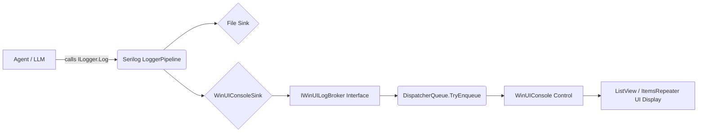
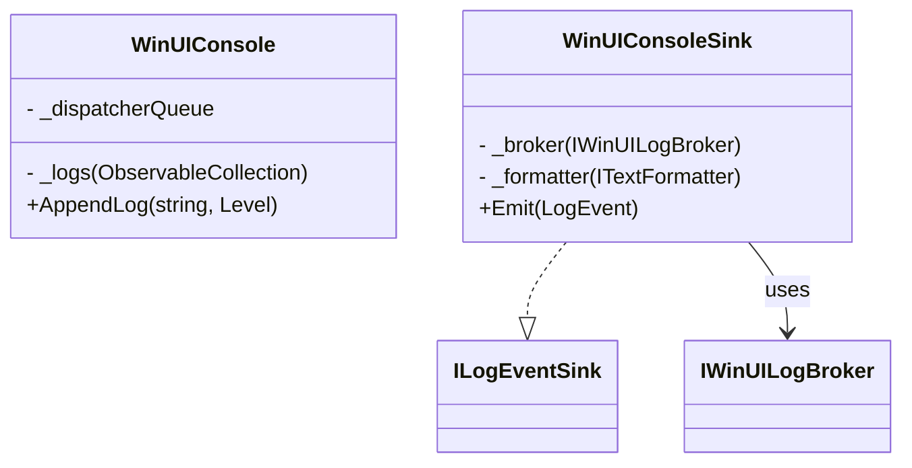

# Assistant Message

**Exported:** 28/10/2026 09:42:47
**Entry ID:** e9
**Session:** agent-d239efbfe3e74543a72fd95dfec8776b

---

Here is the English translation of the technical document, maintaining the professional and structured Markdown format.

***

# Design Document: Real-time WinUI Log Console

**Project:** VnML Studio (LlamaCppSharp Plugin)
**Author:** Nguyen Cong Hoang
**Version:** 1.0

**Objective:** To provide a real-time log display interface (Console), allowing developers and users to monitor Agent activities (reasoning, tool calls, errors) directly on the interface without needing to open external `.txt` files.

---

## 📄 Attachments

*   **File:** `Design Document: Real-time WinUI Log Console` (5.9 KB)

---

## PART 1: HIGH-LEVEL DESIGN (HLD)

### 1.1. Context & Problem

The current system uses Serilog to write logs to files (Rolling File format). This method is good for long-term storage but makes real-time debugging difficult. Developers must switch windows, open files, and reload continuously. Furthermore, end-users cannot see what the Agent is "thinking" unless they view the logs.

### 1.2. Architectural Solution

We will extend Serilog's capabilities by creating a **Custom Sink** (`WinUIConsoleSink`).

The data flow architecture will proceed as follows:

*   **Source:** Modules (Agent, Tool, LLM Client) call `ILogger.LogInformation(...)`.
*   **Pipeline:** Serilog receives the log, formats it, and simultaneously routes it to two destinations:
    *   **File Sink:** Writes to the hard drive (as before).
    *   **WinUI Sink (New):** Routes logs to the interface.
*   **UI Layer:** A Control (`WinUIConsole`) receives the logs and displays them smoothly (without blocking the main thread).

### 1.3. Design Principles (SOLID)

*   **SRP (Single Responsibility Principle):** The `Sink` only handles formatting and forwarding. The `Control` only handles display. The `Broker` (intermediary) only handles thread synchronization.
*   **OCP (Open/Closed Principle):** New `Sinks` (e.g., sending logs via Telegram, saving to SQLite) can be added without modifying the Agent code.
*   **DIP (Dependency Inversion Principle):** The `Sink` does not depend directly on `WinUIConsole`. It communicates via the `IWinUILogBroker` Interface. This allows the `Sink` to push logs to any UI in the future.

### 1.4. Data Flow Diagram



---

## PART 2: DETAIL DESIGN (DD)

### 2.1. Class Diagram

**Interface:**


**Implementation:**



### 2.2. Component Details

#### A. `WinUIConsoleSink` (Serilog Custom Sink)

*   **Task:** Inherit from Serilog's `ILogEventSink`.
*   **Logic:** When a new log arrives (`Emit`), use the injected `ITextFormatter` to convert the `LogEvent` into a `string`. Then, call `_broker.AppendLog(formattedText, level)`.
*   **Note:** The `Emit` method runs on a **Background Thread**. Absolutely do not call direct UI functions here.

#### B. `IWinUILogBroker` & `WinUIConsole`

*   **Task:** Receive the log string and display it on the screen.
*   **Thread-safe Mechanism:** Since logs arrive from a background thread, `WinUIConsole` uses `DispatcherQueue.GetForCurrentThread().TryEnqueue(() => { ... })` to ensure that adding items to the UI list happens on the **Main UI Thread**.
*   **Memory Management:** Limit the number of displayed logs (e.g., `MaxLines = 2000`). If the limit is exceeded, automatically remove the oldest lines (FIFO) to prevent memory leaks.

#### C. `WinUIConsoleSinkExtensions`

*   **Task:** Provide an extension method `WriteTo.WinUIConsole(...)` to seamlessly integrate it into the Serilog `LoggerConfiguration` setup.

### 2.3. Dependency Injection (DI) Configuration

Modify the `LoggerConfiguration` initialization in `DependencyInjection.cs`. You need to pass the `IServiceProvider` to retrieve the instance of `IWinUILogBroker` (which is the registered `Control`).

```csharp
// Example:
var uiBroker = serviceProvider.GetService<IWinUILogBroker>();
var config = new LoggerConfiguration()
    .WriteTo.File("logs.txt")
    .WriteTo.WinUIConsole(uiBroker); // Only add if uiBroker is not null
```

### 2.4. Edge Cases & Solutions

| Risk / Problem | Solution |
| :--- | :--- |
| RAM overflow due to excessive logs | Use a **Bounded Collection** mechanism. Limit to 2000 lines. Use **Virtualization** on the UI `ListView`. |
| App Crash due to incorrect Thread | Must use `DispatcherQueue.TryEnqueue` in the `Broker`. Do not update the UI directly. |
| UI Lag when logs are continuous | Apply **Batching**: Instead of adding every line, the `Broker` can buffer logs and update the UI every 100ms. (To be implemented in Phase 2 if necessary). |
| Very long logs (Error stack trace) | **Truncate** the string length before pushing to the UI (e.g., maximum 1000 characters/line). |
