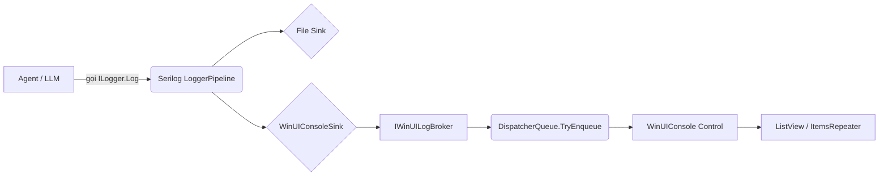
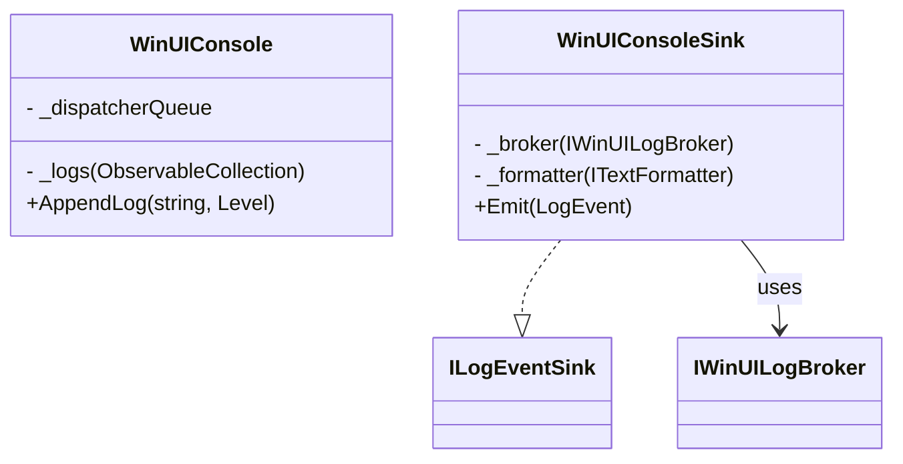

# Assistant Message

**Exported:** 28/10/2026 09:30:23
**Entry ID:** e3
**Session:** agent-d239efbfe3e74543a72fd95dfec8776b

---

Đây là tài liệu đã được định dạng lại theo chuẩn Markdown. Tôi đã sử dụng các tiêu đề, danh sách, bảng và khối mã (code blocks) để làm cho tài liệu trở nên rõ ràng và dễ đọc hơn.

***

# Tài liệu Thiết kế: Real-time WinUI Log Console

**Dự án:** VnML Studio (Plugin LlamaCppSharp)
**Tác giả:** Nguyễn Công Hoàng
**Phiên bản:** 1.0

**Mục tiêu:** Cung cấp giao diện hiển thị log (Console) theo thời gian thực (real-time), giúp lập trình viên và người dùng theo dõi hoạt động của Agent (suy luận, gọi tool, lỗi) trực tiếp trên giao diện mà không cần mở file `.txt` bên ngoài.

---

## 📄 Attachments

*   **File:** `Tài liệu Thiết kế: Real-time WinUI Log Console` (5.9 KB)

---

## PHẦN 1: HIGH-LEVEL DESIGN (HLD)

### 1.1. Bối cảnh & Vấn đề

Hệ thống hiện tại sử dụng Serilog để ghi log ra file (định dạng Rolling File). Phương pháp này tốt cho việc lưu trữ lâu dài nhưng gây khó khăn khi cần debug trực tiếp (real-time). Lập trình viên phải chuyển cửa sổ, mở file, và reload liên tục. Ngoài ra, người dùng cuối không thể thấy được Agent đang "suy nghĩ" gì nếu không xem log.

### 1.2. Giải pháp kiến trúc

Chúng ta sẽ mở rộng sức mạnh của Serilog bằng cách tạo một **Custom Sink** (`WinUIConsoleSink`).

Kiến trúc luồng dữ liệu sẽ đi như sau:

*   **Source:** Các module (Agent, Tool, LLM Client) gọi `ILogger.LogInformation(...)`.
*   **Pipeline:** Serilog nhận log, định dạng (format) và đẩy song song ra 2 đích:
    *   **File Sink:** Ghi ra ổ cứng (như cũ).
    *   **WinUI Sink (Mới):** Chuyển log về giao diện.
*   **UI Layer:** Một Control (`WinUIConsole`) nhận log và hiển thị mượt mà (không block luồng chính).

### 1.3. Các nguyên tắc thiết kế (SOLID)

*   **SRP (Single Responsibility):** `Sink` chỉ lo việc format và chuyển tiếp. `Control` chỉ lo hiển thị. `Broker` (trung gian) chỉ lo việc đồng bộ luồng (Thread marshaling).
*   **OCP (Open/Closed):** Có thể thêm các `Sink` khác (ví dụ: gửi log qua Telegram, lưu vào SQLite) mà không sửa code Agent.
*   **DIP (Dependency Inversion):** `Sink` không phụ thuộc trực tiếp vào `WinUIConsole`. Nó giao tiếp qua Interface `IWinUILogBroker`. Nhờ đó, `Sink` có thể dùng để đẩy log vào bất kỳ UI nào khác trong tương lai.

### 1.4. Sơ đồ luồng dữ liệu (Data Flow)



---

## PHẦN 2: DETAIL DESIGN (DD)

### 2.1. Sơ đồ Class (Class Diagram)

**Interface:**


**Implementation:**



### 2.2. Chi tiết các Component

#### A. `WinUIConsoleSink` (Serilog Custom Sink)

*   **Nhiệm vụ:** Kế thừa `ILogEventSink` của Serilog.
*   **Logic:** Khi có log mới (`Emit`), sử dụng `ITextFormatter` (truyền vào từ cấu hình) để biến `LogEvent` thành `string`. Sau đó gọi `_broker.AppendLog(formattedText, level)`.
*   **Lưu ý:** Hàm `Emit` chạy trên **Background Thread**. Tuyệt đối không gọi trực tiếp các hàm UI ở đây.

#### B. `IWinUILogBroker` & `WinUIConsole`

*   **Nhiệm vụ:** Nhận `string` log và hiển thị lên màn hình.
*   **Cơ chế Thread-safe:** Vì log đến từ luồng nền, `WinUIConsole` sử dụng `DispatcherQueue.GetForCurrentThread().TryEnqueue(() => { ... })` để đảm bảo việc thêm item vào danh sách UI được thực hiện trên **luồng chính (Main UI Thread)**.
*   **Quản lý bộ nhớ:** Giới hạn số lượng log hiển thị (ví dụ: `MaxLines = 2000`). Nếu vượt quá, tự động xóa các dòng cũ nhất (FIFO) để tránh tràn RAM (Memory Leak).

#### C. `WinUIConsoleSinkExtensions`

*   **Nhiệm vụ:** Cung cấp hàm mở rộng (Extension Method) `WriteTo.WinUIConsole(...)` để gắn vào cấu hình `LoggerConfiguration` của Serilog một cách liền mạch.

### 2.3. Cấu hình DI (Dependency Injection)

Thay đổi hàm khởi tạo `LoggerConfiguration` trong `DependencyInjection.cs`. Cần truyền `IServiceProvider` để lấy instance của `IWinUILogBroker` (chính là `Control` đã được đăng ký vào DI).

```csharp
// Ví dụ:
var uiBroker = serviceProvider.GetService<IWinUILogBroker>();
var config = new LoggerConfiguration()
    .WriteTo.File("logs.txt")
    .WriteTo.WinUIConsole(uiBroker); // Chỉ thêm nếu uiBroker != null
```

### 2.4. Các Edge Cases & Giải pháp

| Rủi ro / Vấn đề | Giải pháp |
| :--- | :--- |
| Tràn RAM do log quá nhiều | Sử dụng cơ chế **Bounded Collection**. Giới hạn 2000 dòng. Dùng **Virtualization** trên UI `ListView`. |
| Crash App do sai Thread | Bắt buộc dùng `DispatcherQueue.TryEnqueue` trong `Broker`. Không update UI trực tiếp. |
| Giật lag UI khi log liên tục | Áp dụng kỹ thuật **Batching (Gom log)**: Thay vì add từng dòng, `Broker` có thể lưu vào buffer và cập nhật UI mỗi 100ms một lần. (Sẽ làm ở phase 2 nếu cần). |
| Log quá dài (Error stack trace) | **Cắt bớt (Truncate)** độ dài string trước khi đẩy lên UI (ví dụ: tối đa 1000 ký tự/dòng). |
