# Assistant Message

**Exported:** 15/10/2026 14:40:35
**Entry ID:** e3
**Session:** agent-c85f41b91123453fb647d9f8bf3e1da8

---

Đây là nội dung đã được định dạng lại theo chuẩn Markdown, đảm bảo cấu trúc, tiêu đề, đoạn văn, và các khối mã (code blocks) được trình bày rõ ràng và dễ đọc nhất.

***

# ADR-001: Chọn thư viện để tạo chart trong Excel export

> **Status:** Accepted
> **Date:** 2026-10-12
> **Deciders:** Nguyễn Công Hoàng
> **Affects:** `VnMLStudio.Plugin.MMO.DocumentIO.Exporters.ExcelDocumentExporter`

---

## Context

Khi implement feature "Export conversation sang Excel", requirement ban đầu chỉ là ghi data dạng bảng. Sau đó, user feedback yêu cầu **tự động generate chart** từ numeric data trong markdown tables — để report trực quan hơn, không cần user mở Excel rồi tự vẽ chart.

Chúng tôi đã chọn `ClosedXML` cho Excel data operations từ đầu vì:
- API cao cấp hơn `DocumentFormat.OpenXml` raw
- Fluent style, dễ maintain
- MIT license, không lo commercial
- Performance tốt cho data size vừa phải

Vấn đề phát sinh: cần thêm chart support, nhưng chưa rõ `ClosedXML` có hỗ trợ hay không.

---

## Decision Drivers

1. **Chart support** — requirement cốt lõi, không thể compromise
2. **License compatibility** — không dùng commercial license cho open-source framework
3. **Maintenance cost** — API không quá phức tạp để maintain lâu dài
4. **Migration cost** — nếu phải đổi library, chi phí viết lại code hiện tại bao nhiêu
5. **Community + maturity** — thư viện phải stable, có documentation, có StackOverflow answers

---

## Options Considered

### Option A: ClosedXML (giữ nguyên)

**Ưu điểm:**
- Đã dùng cho data operations
- Không cần đổi code hiện tại
- MIT license

**Nhược điểm — DEAD END:**
- **KHÔNG hỗ trợ tạo chart.** Không phải "hỗ trợ hạn chế" — mà là **zero support**.
- Class `XLChart` tồn tại trong source nhưng **chỉ là stub rỗng**. Không có method, không có implementation.
- GitHub issue #1294 (2019), #2721 (2025) xác nhận: maintainers nói rõ "no chart support, will not implement".
- Đây là architectural limitation, không phải backlog item.

**Verdict:** ❌ Loại bỏ. Không thể dùng cho requirement chart.

---

### Option B: EPPlus

**Ưu điểm:**
- Chart support **xuất sắc nhất** trong các option
- Fluent API đẹp, dễ code
- Full chart types: Line, Bar, Pie, Scatter, Bubble, Stock, Radar, Surface
- Documentation tốt, community lớn

**Nhược điểm — LICENSE BLOCKER:**
- Từ version 5 (2020), EPPlus chuyển sang **Polyform Noncommercial License**.
- Commercial use requires **paid license** (~$500-2000/year depending on team size).
- VNML Agent Framework là open-source (MIT), nhưng VNML Studio app có thể dùng trong enterprise environment.
- Không thể đảm bảo mọi user của VNML sẽ không dùng commercial → risk legal.

**Verdict:** ❌ Loại bỏ. License không phù hợp với open-source framework.

---

### Option C: `DocumentFormat.OpenXml` (raw SDK)

**Ưu điểm:**
- Microsoft official, MIT license
- Đã có sẵn trong project (dùng cho Word export)
- Full control — có thể tạo mọi chart type Excel hỗ trợ
- Zero additional dependency

**Nhược điểm:**
- API **rất low-level** — manipulate XML trực tiếp
- Cần ~200-400 dòng code cho **một chart cơ bản** (chart XML structure phức tạp: `ChartPart`, `DrawingPart`, relationships, series, axes, plot area)
- Debug khó — bug là XML invalid, Excel mở không được
- Không có IntelliSense tốt cho chart schema
- Time-to-implement cao

**Verdict:** ⚠️ Feasible nhưng không recommend cho scope hiện tại.

---

### Option D: NPOI

**Ưu điểm:**
- **Apache 2.0** — miễn phí commercial, tương thích mọi use case
- Chart support **đầy đủ** — Line, Bar, Area, Radar, Pie, Scatter, Bubble, Surface
- API trung bình (không fluent như EPPlus, nhưng cao hơn OpenXml raw)
- Mature — port từ Apache POI (Java), tồn tại từ 2010
- ~50M downloads trên NuGet
- Community VN + quốc tế active

**Nhược điểm:**
- API hơi "Java-style" (getter/setter thay vì property)
- Documentation ít hơn EPPlus
- Chart API mới (`chart.CreateData(ChartTypes.X, ...)`) chưa được document đầy đủ — phải đọc source code để hiểu
- Không có đầy đủ chart types như EPPlus (thiếu 3D variants)

**Verdict:** ✅ Recommended.

---

### Option E: Hybrid — ClosedXML (data) + OpenXml (chart)

**Ưu điểm:**
- Giữ code hiện tại cho data
- Chỉ thêm ~250 dòng cho chart injection
- Cả 2 library đều MIT

**Nhược điểm:**
- Phải save file bằng ClosedXML → mở lại bằng OpenXml → inject chart → save lại
- **Performance hit** cho file lớn (đọc/ghi 2 lần)
- **Complex state management** — 2 library giữ 2 model khác nhau của cùng file
- Debug phức tạp hơn nhiều (2 layers)

**Verdict:** ⚠️ Không đáng. Complexity không tương xứng với benefit.

---

## Decision

**Chọn Option D: NPOI.**

Chúng tôi thay `ClosedXML` bằng `NPOI` cho Excel export operation. Cụ thể:

```xml
<!-- Bỏ -->
<PackageReference Include="ClosedXML" Version="0.104.1" />

<!-- Thêm -->
<PackageReference Include="NPOI" Version="2.7.1" />
```

**Lý do:**

*   **License fit** — Apache 2.0 cho phép mọi use case (commercial + open-source), không cần consider legal.
*   **Chart support thực sự** — có API thật, không phải stub, có thể rely on.
*   **Migration effort hợp lý** — API NPOI tuy khác nhưng pattern tương tự (workbook → sheet → row → cell). ~1 ngày refactor.
*   **Không over-engineer** — không phải viết low-level OpenXml XML, tiết kiệm 300-400 dòng code.
*   **Trade-off chấp nhận được** — thiếu 3D chart không critical cho use case "conversation export".

### Consequences

**Positive**
*   Excel export có chart hoạt động (Line/Bar/Column/Pie/Area/Radar/Scatter).
*   Zero licensing risk cho commercial use.
*   Không có "dependency lock-in" từ closed-source library.
*   Đã validate end-to-end với Vietnamese data — không mojibake.

**Negative**
*   Refactor cost: ExcelDocumentExporter phải viết lại từ ClosedXML API → NPOI API (~350 dòng).
*   API learning curve: Chart API mới của NPOI chưa document đầy đủ, phải đọc source code.
*   Missing chart types: Không có 3D variants (Pie3D, Bar3D). Có thể thêm sau nếu cần.

**Import side unchanged?** — Import vẫn giữ ClosedXML vì đọc data không cần chart. Có 2 library cho Excel operations (ClosedXML import + NPOI export).

**Neutral**
*   Binary size tăng nhẹ: NPOI ~3 MB, ClosedXML ~5 MB. Cả 2 cùng tồn tại → ~8 MB. Acceptable cho desktop app.
*   2 libraries cho Excel: Không ideal về mặt "one tool per job", nhưng mỗi library mạnh ở 1 mặt (ClosedXML đọc tốt hơn, NPOI viết chart tốt hơn).

### Implementation Notes

#### Chart type mapping
`ChartKind` enum → `NPOI ChartTypes`:

| ChartKind | NPOI ChartTypes |
| :--- | :--- |
| Line | `ChartTypes.LINE` |
| Bar | `ChartTypes.BAR` (horizontal by default) |
| Column | `ChartTypes.BAR` (swap axes roles — tricky, may not work perfectly) |
| Pie | `ChartTypes.PIE` (no axes) |
| Area | `ChartTypes.AREA` |
| Radar | `ChartTypes.RADAR` |
| Scatter | `ChartTypes.SCATTER` (requires 2 numeric columns) |

#### NPOI chart API pattern (verified)
```csharp
// Verified from official NPOI examples:
// https://github.com/nissl-lab/npoi-examples/blob/main/xssf/LineChart/Program.cs

var drawing = (XSSFDrawing)sheet.CreateDrawingPatriarch();
var anchor = drawing.CreateAnchor(0, 0, 0, 0, col1, row1, col2, row2);
var chart = (XSSFChart)drawing.CreateChart(anchor);

chart.SetTitleText("My Chart");
var legend = chart.GetOrAddLegend();
legend.Position = LegendPosition.Bottom;

var bottomAxis = chart.CreateCategoryAxis(AxisPosition.Bottom);
var leftAxis = chart.CreateValueAxis(AxisPosition.Left);

var data = chart.CreateData(ChartTypes.LINE, bottomAxis, leftAxis);
var categoryData = DataSources.FromStringCellRange(sheet, categoryRange);
var valueData = DataSources.FromNumericCellRange(sheet, valueRange);
data.AddSeries(categoryData, valueData);

chart.Plot(data);
```

#### Known pitfalls
*   **Pie chart** — pass null for both axes: `chart.CreateData(ChartTypes.PIE, null, null)`.
*   **Scatter chart** — requires numeric X AND Y columns. Fallback to Line if only 1 numeric column.
*   **Column vs Bar** — NPOI treats "ColumnClustered" via `ChartTypes.BAR` (orientation via axes). Không có enum `COLUMN` riêng.

#### Alternatives Rejected — Why
| Option | Rejected because |
| :--- | :--- |
| A. ClosedXML | Zero chart support — dead end |
| B. EPPlus | License blocker — commercial use requires payment |
| C. OpenXml raw | Too much code for scope — ~400 lines per chart |
| E. Hybrid | Complexity not justified — 2 model views of same file |

### Follow-up Actions

☑ Replace ClosedXML with NPOI in `ExcelDocumentExporter`
☑ Implement `NpoiChartBuilder` with Line/Bar/Column/Pie/Area/Radar/Scatter
□ TODO: Add 3D chart variants (Pie3D, Bar3D) if user requests
□ TODO: Consider keeping ClosedXML only for import (current state) — evaluate consolidating to NPOI for import too in v1.2

***

## 📄 File 2 — Sequence Diagrams cho DocumentIO

**Path gợi ý:** `docs/DocumentIO-SequenceDiagrams.md`

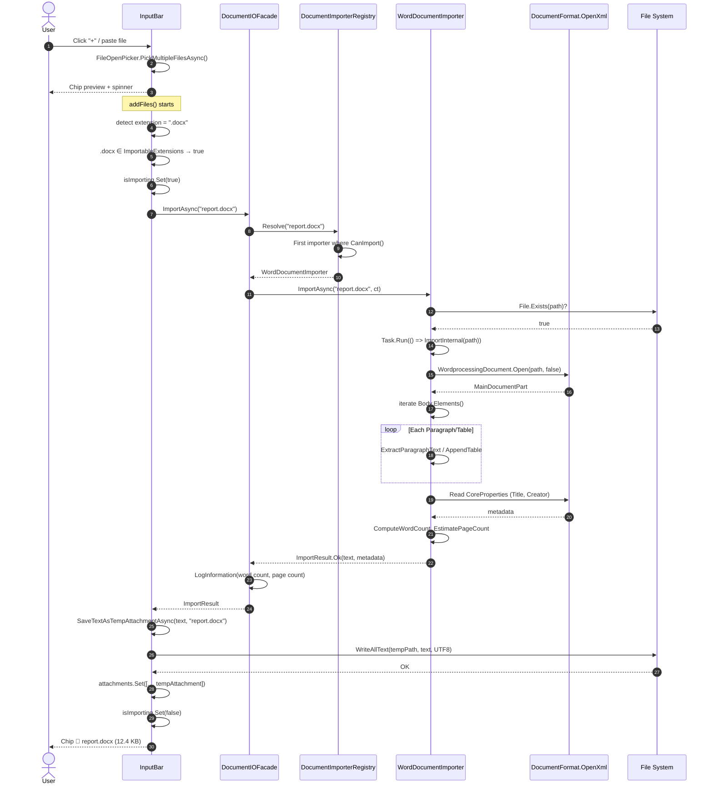

### 2. Import Flow — Error Path
File `.docx` corrupt hoặc password-protected.

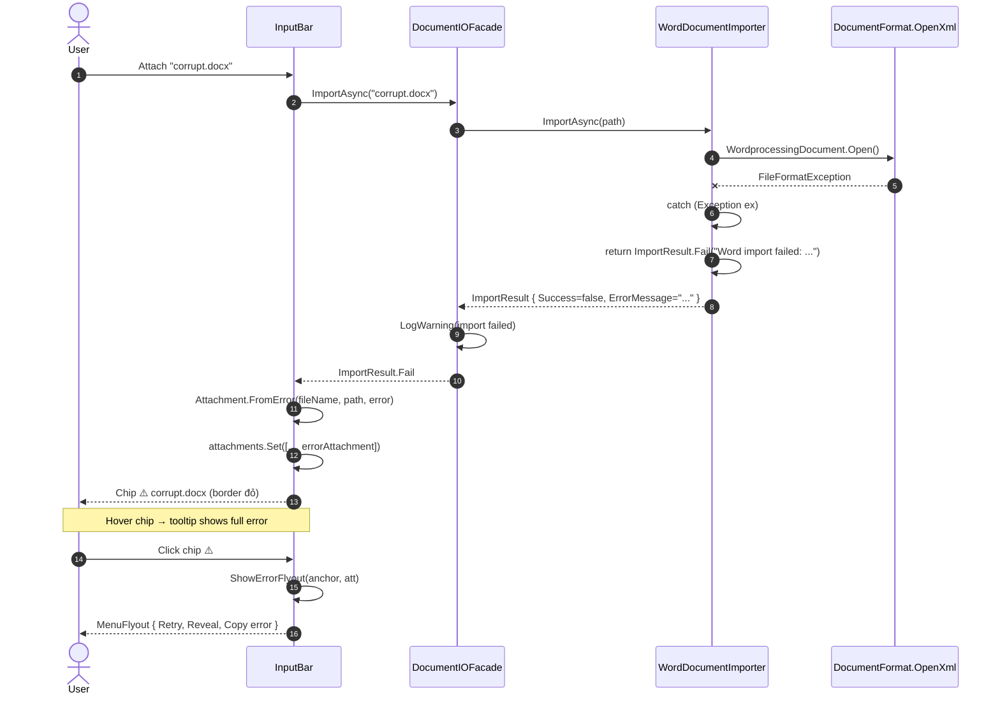

### 3. Import Flow — Retry After Fix
User fix file, click "Thử import lại" từ error flyout.

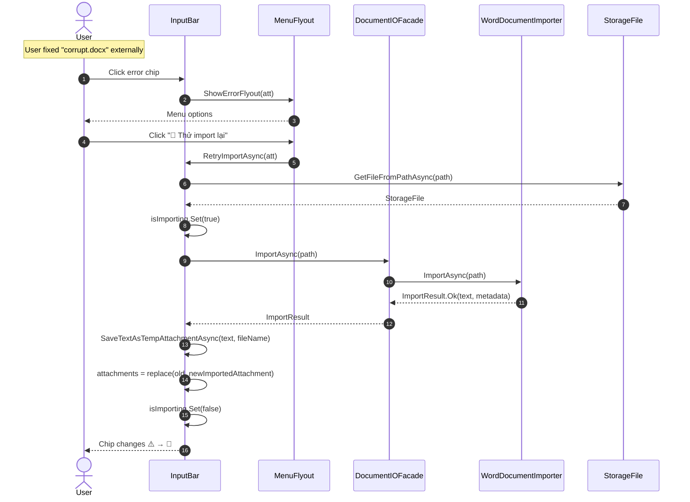

### 4. Export Flow — Save As Dialog + Rendering
User export assistant message → PDF với syntax highlighting.

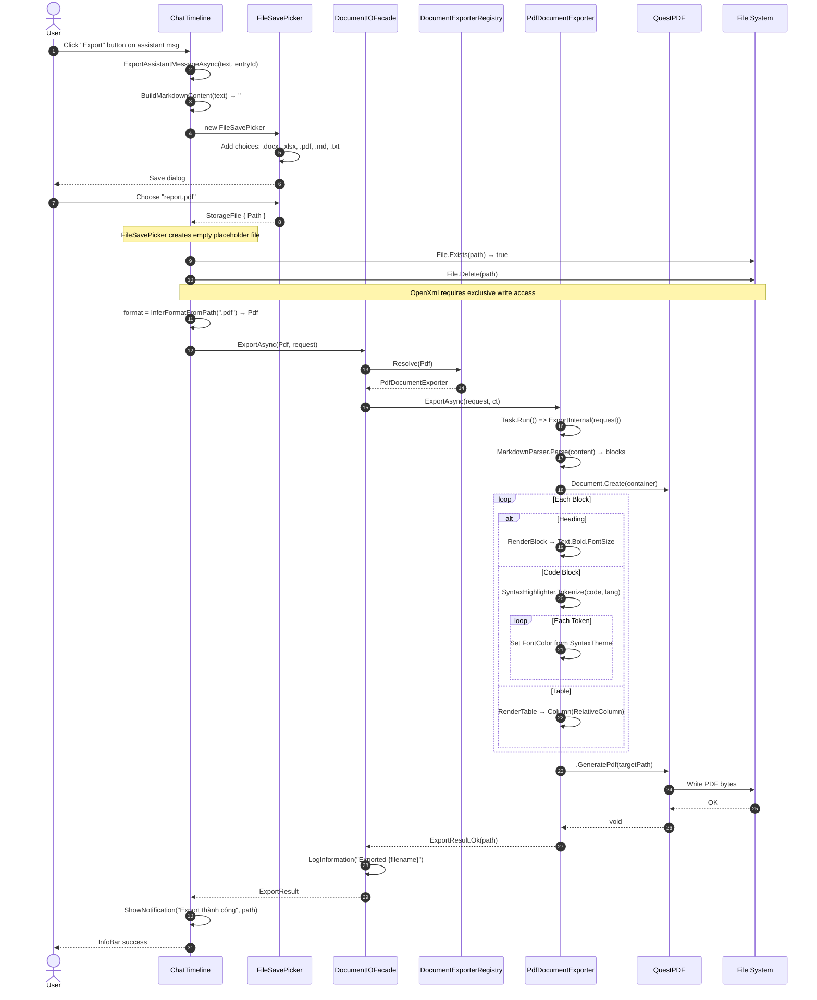

### 5. Export Flow — Excel with Charts
User export markdown table with numeric data → auto chart.

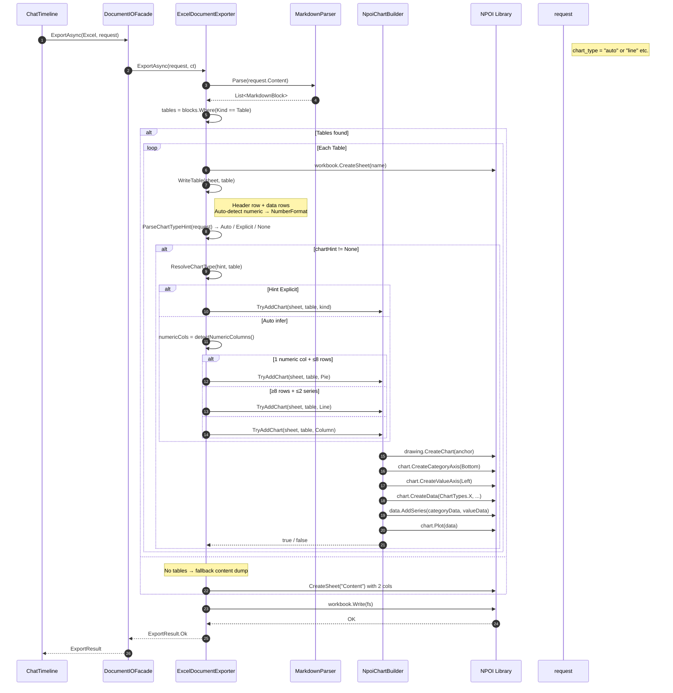

### 6. Import Cache + Prompt Merge
Full lifecycle: user attach file → import → merge into LLM prompt.

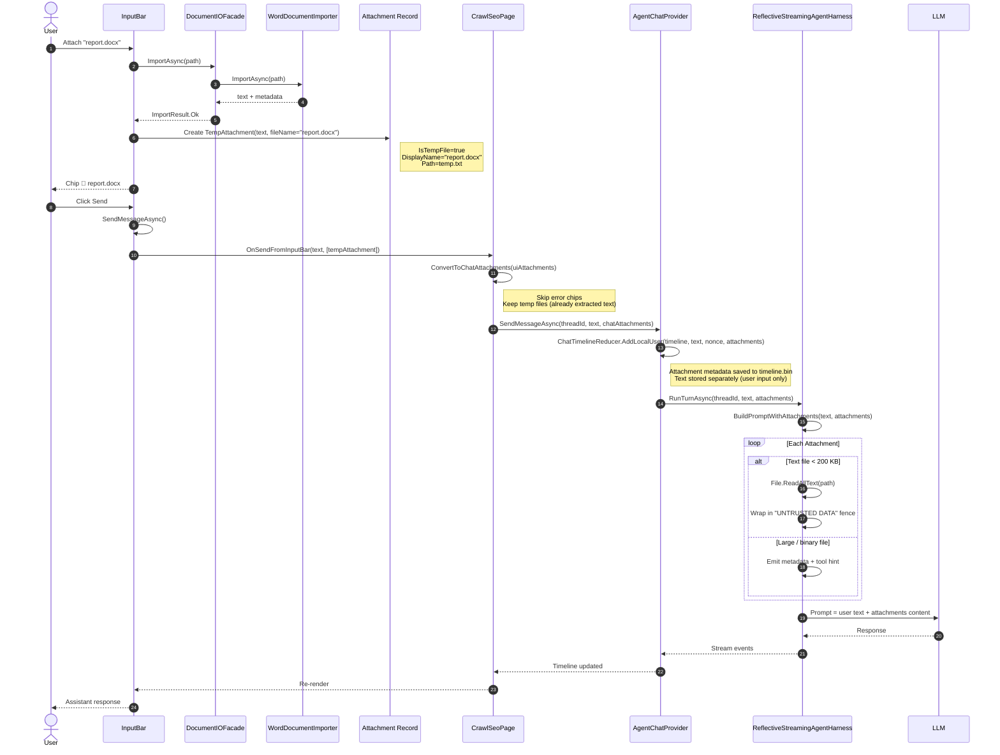

### 7. FileOpenPicker + Attachment Workflow — Detailed
Zoom vào đoạn `addFiles` với merge/lock.

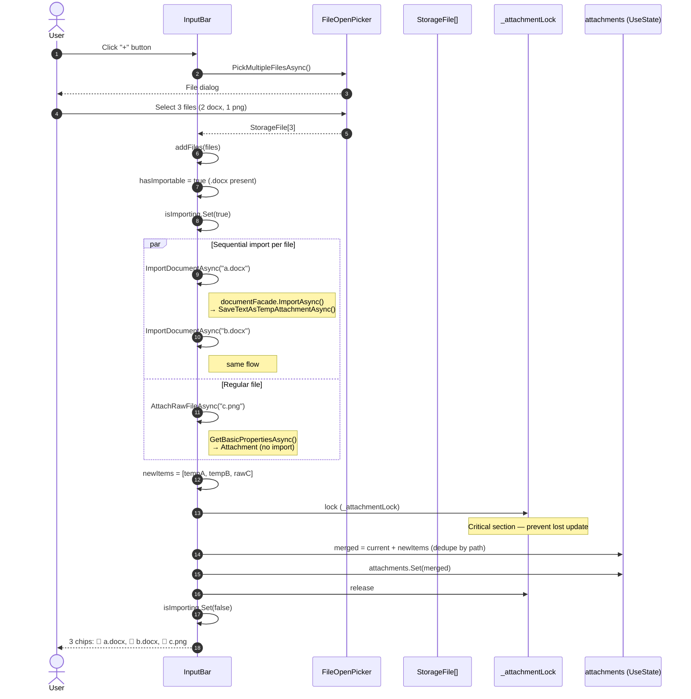

### 8. Error Flyout Interaction
Zoom vào error chip flyout với 3 actions.

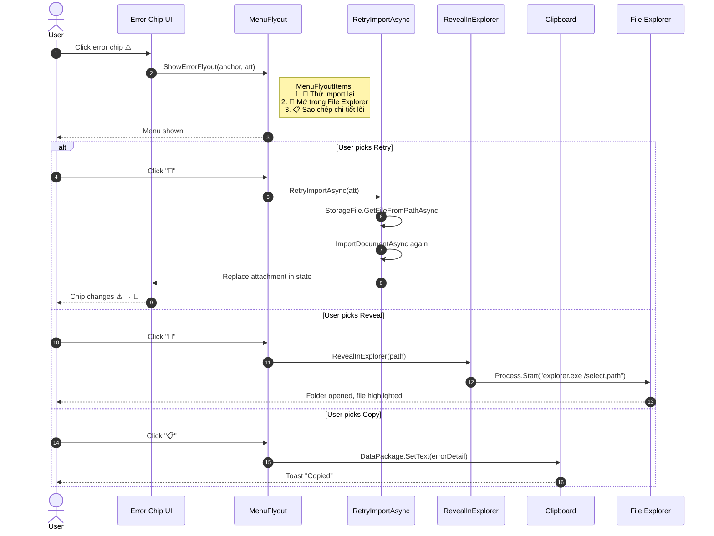

### 9. Save File Picker + Format Inference
Zoom vào `ChatTimeline.ExportMarkdownAsync`.

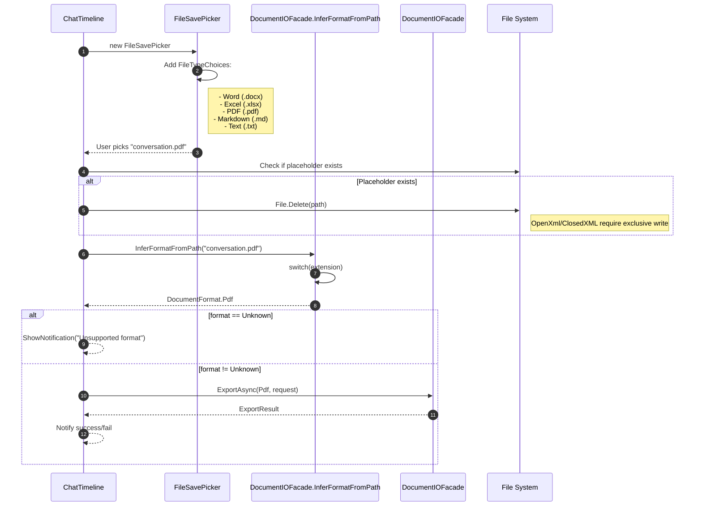

### 10. Concurrency — Multiple Files, Parallel Import
3 file cùng lúc, giả định `addFiles` called concurrently.

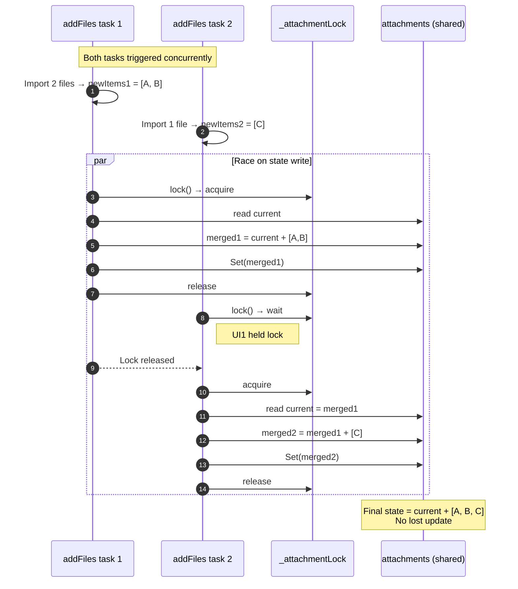

### 11. Font Fallback Chain — PDF Export
Zoom vào PDF export khi text chứa box-drawing + emoji.

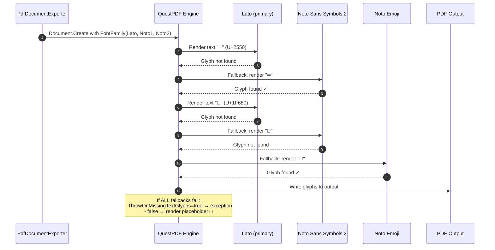

### 12. Summary Table — Key Interaction Points

| Flow | Participants | Critical path |
| :--- | :--- | :--- |
| Import happy | InputBar → Facade → Registry → Importer | File read + parse |
| Import error | InputBar → Facade → Importer catch | Return ImportResult.Fail |
| Retry | Error chip → Flyout → Facade | Same as import, replace state |
| Export | ChatTimeline → Facade → Exporter | Parse markdown + render |
| Prompt merge | Harness → BuildPromptWithAttachments | Inline under budget |
| Concurrency | Multiple addFiles | Guard by `_attachmentLock` |
| Font fallback | QuestPDF → font chain | First glyph match wins |
